<picture>
  <source media="(prefers-color-scheme: dark)" srcset="./dark.svg">
  <source media="(prefers-color-scheme: light)" srcset="./light.svg">
  
</picture>

# Hi, I'm Adarsh 👋

**CSE Engineer · AI / ML · Data Science · Cyber Security**

I’m a Computer Science & Engineering student building projects across **AI/ML, computer vision, data science, cyber security, and web development**.

## 🎯 Current Focus

- 🤖 Artificial Intelligence & Machine Learning
- 👁️ Computer Vision
- 📊 Data Science & Python
- 🔐 Cyber Security
- 🌐 Web & application development
- 📚 Preparing for software/engineering opportunities

## 🧰 Technical Stack

**Languages**
`Python` `JavaScript` `C` `HTML` `CSS` `PHP`

**AI / Data**
`Pandas` `NumPy` `Matplotlib` `scikit-learn` `PyTorch`

**Web / Backend**
`Node.js` `PHP` `MySQL` `React Native`

**Tools**
`GitHub` `VS Code` `Jupyter Notebook` `Anaconda` `XAMPP`

## 🚀 Selected Projects

| Project | Description |
|---|---|
| **Automated Microbial Colony Counting** | Image analysis project for segmentation and colony counting. |
| **COVID-19 Data Analysis** | Python-based analysis and visualization of COVID-19 datasets. |
| **Sound Mind** | Machine-learning project focused on depression and anxiety detection. |
| **Job Recommender** | Web application with frontend and Node.js backend components. |
| **Employee CRUD** | PHP + MySQL application for employee data management. |
| **Food Delivery App** | React Native application explored as a research/project implementation. |

## 🎓 Education

**Bachelor of Engineering — Computer Science & Engineering**  
RV Institute of Technology and Management, Bengaluru  
Affiliated to VTU · Expected 2027

## 📌 Profile Philosophy

> Learn continuously. Build practical projects. Understand the fundamentals. Ship what you learn.

## 📫 Connect

- 🐙 **GitHub:** [adarshnp552-cyber](https://github.com/adarshnp552-cyber)

I keep this profile focused on my technical learning, projects, experiments, and engineering work.

---

Built with a terminal-inspired GitHub profile design. Dark/light theme switches automatically.
